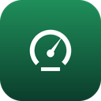
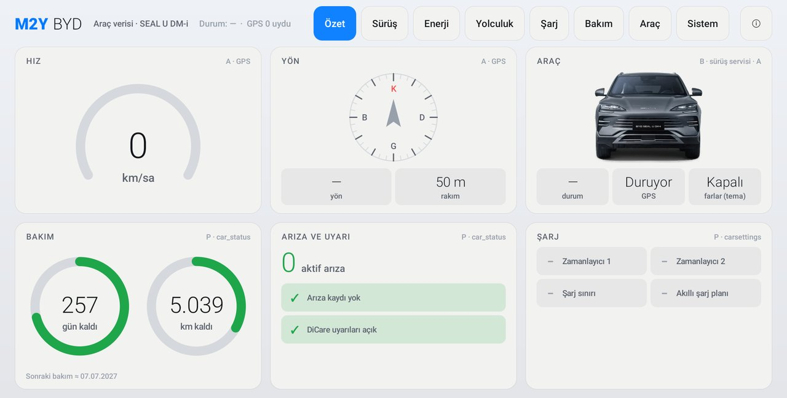
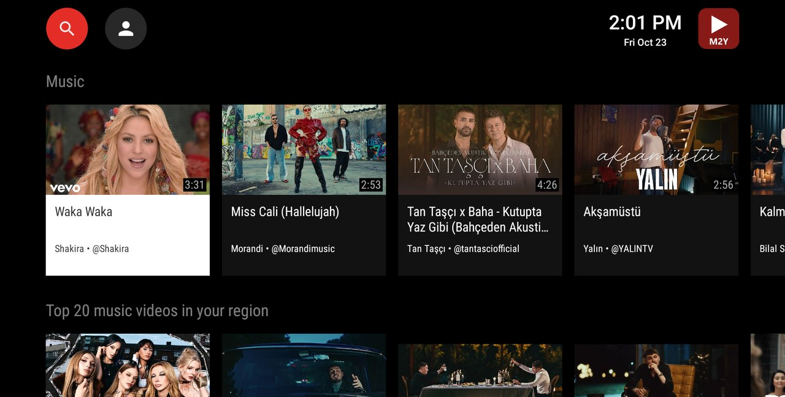
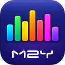
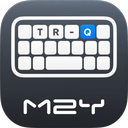
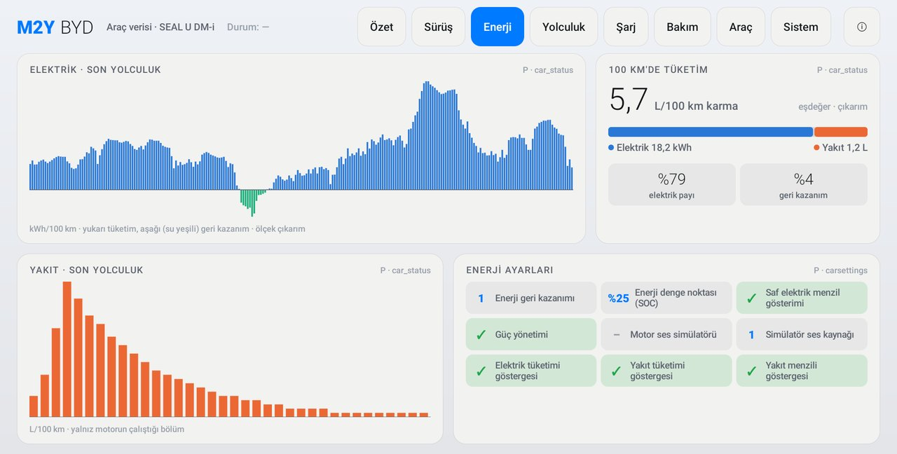
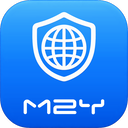

<p align="center"></p>
<h1 align="center">M2Y for BYD</h1>
<p align="center"><b>Free, ad-free, tracking-free apps built for the BYD multimedia screen.</b><br><sub>Ücretsiz, reklamsız, izlemesiz BYD multimedya ekranı uygulamaları · Бесплатные приложения для мультимедийного экрана BYD без рекламы и слежки</sub></p>
<p align="center">
  
  
  
  
  
  
  <a href="https://github.com/mehmetmesut/byd-m2y"></a>
</p>
<p align="center">
  <a href="#app-gallery"><b>⬇ Downloads</b></a> ·
  <a href="https://byd.mehmetmesut.com">byd.mehmetmesut.com</a> ·
  <a href="https://github.com/mehmetmesut/byd-m2y"><b>⭐ Star this repo</b></a>
</p>
<p align="center"> </p>

<h2 align="center">App gallery</h2>
<table>
  <tr>
    <td width="50%" align="center" valign="top">
      <br>
      <b>M2Y Tube</b> <sub>1.25.07.68.0 · 27.3 MB</sub><br>
      A touch-first YouTube client built for the car screen.<br>
      <br>
      <a href="https://github.com/mehmetmesut/byd-m2y-tube/releases/download/1.25.07.68.0/M2YTube_1.25.07.68.0_arm64-v8a.apk"><b>⬇ APK</b></a> · <a href="https://github.com/mehmetmesut/byd-m2y-tube">Source</a>
    </td>
    <td width="50%" align="center" valign="top">
      <br>
      <b>M2Y EQ</b> <sub>1.25.07.68.3 · 128 KB</sub><br>
      System-wide equalizer tuned for the Infinity sound system.<br>
      <br>
      <a href="https://github.com/mehmetmesut/byd-m2y-eq/releases/download/1.25.07.68.3/M2YEQ_1.25.07.68.3.apk"><b>⬇ APK</b></a> · <a href="https://github.com/mehmetmesut/byd-m2y-eq">Source</a>
    </td>
  </tr>
  <tr>
    <td width="50%" align="center" valign="top">
      <br>
      <b>M2Y Board</b> <sub>1.25.07.68.0 · 4.5 MB</sub><br>
      Offline Turkish Q keyboard with a number row.<br>
      <br>
      <a href="https://github.com/mehmetmesut/byd-m2y-board/releases/download/1.25.07.68.0/M2YBoard_1.25.07.68.0.apk"><b>⬇ APK</b></a> · <a href="https://github.com/mehmetmesut/byd-m2y-board">Source</a>
    </td>
    <td width="50%" align="center" valign="top">
      <br>
      <b>M2Y TV</b> <sub>1.25.07.68.0 · 1.7 MB</sub><br>
      Light, ad-free IPTV player (M3U and Xtream Codes).<br>
      <br>
      <a href="https://github.com/mehmetmesut/byd-m2y-tv/releases/download/1.25.07.68.0/M2YTV_1.25.07.68.0.apk"><b>⬇ APK</b></a> · <a href="https://github.com/mehmetmesut/byd-m2y-tv">Source</a>
    </td>
  </tr>
  <tr>
    <td width="50%" align="center" valign="top">
      <br>
      <b>M2Y BYD</b> <sub>1.0.0 · 223 KB</sub><br>
      Your car's data as pictures: maintenance, energy, trips.<br>
      <br>
      <a href="https://byd.mehmetmesut.com/indir/M2YBYD_1.0.0.apk"><b>⬇ APK</b></a> · Source: after in-car testing
    </td>
    <td width="50%" align="center" valign="top">
      <br>
      <b>M2Y Browser</b> <sub>coming soon</sub><br>
      De-Googled Chromium with built-in ad blocking.<br>
      <br>
      <a href="https://github.com/mehmetmesut/byd-m2y-browser/actions"><b>⏳ Build in progress</b></a> · <a href="https://github.com/mehmetmesut/byd-m2y-browser">Source</a>
    </td>
  </tr>
</table>
<p align="center"><sub>All APKs are signed with the same M2Y key; updates install over the previous version and keep your settings. SHA-256 sums: <a href="https://byd.mehmetmesut.com">byd.mehmetmesut.com</a></sub></p>

<details open>
<summary><b>🇬🇧 English</b></summary>

### My story

I am in love with my **BYD SEAL U DM-i**. The apps in the stores did not fit the car: ads, Google Play dependencies, phone or TV layouts, and a heavy load on the processor. So I built the apps I needed for myself first: free, transparent, with no ads and no tracking, using as little CPU, RAM and storage as possible, quick to open, smooth to touch and stable. Then I made them installable on **BYD multimedia screens (DiLink)** and shared them, so every BYD owner can use them too.

### What makes these apps different

Every decision starts from a measured fact about the head unit (BYD DiLink 3.0, Android 10, Qualcomm SM6125 with 8 cores, Adreno 610, 8 GB RAM, 1920×1080 touch screen at 240 dpi and 60 Hz):

| Head unit fact | Design decision |
|---|---|
| Android 10 (API 29) | Every APK supports API 29; nothing depends on newer system features. |
| arm64-v8a CPU | Builds target arm64-v8a. |
| No Google services | No Google Play or GMS dependency anywhere; M2Y Tube works without signing in, M2Y Board works fully offline. |
| 1920×1080 landscape touch, 240 dpi | Large touch targets, landscape-first layouts, tap and swipe gestures; M2Y Browser keeps only 240 dpi resources. |
| Hardware video decoder | M2Y Tube is capped at 1080p60 and defaults to hardware VP9 at 720p30 (AV1 off); M2Y TV uses the hardware decoder with a single player. |
| `heapgrowthlimit` of 256 MB per app | Small memory footprints: Music mode drops the video, M2Y TV runs one player, APKs range from 128 KB to 27.3 MB. |
| Infinity sound system | M2Y EQ is tuned to the engine's real frequency bins and steps aside during phone calls. |
| Stock installer blocks third-party APKs ("driving safety") | Installation over ADB, or the one-click Windows installer. |
| BYD's vehicle API is signature-protected | M2Y BYD shows only the data that is readable, read-only. State of charge and tyre data are not shown. |

### The apps

**M2Y Tube** (1.25.07.68.0, 27.3 MB) is a touch-first YouTube client based on SmartTube (MIT). Quality runs from 360p up to 1080p60, defaulting to 720p30 on the hardware VP9 decoder. Tap for controls, swipe left or right for the previous or next video, and the quality and speed buttons sit above the controls. Music mode turns off the picture and shows the video cover, which saves data and CPU. Audio keeps playing in the background. It is ad-free without signing in; signing in with your own account is optional.

**M2Y EQ** (1.25.07.68.3, 128 KB) is a system-wide equalizer written in plain Kotlin with no dependencies. It is a single effect on all system audio with 10 or 25 bands aligned to the real frequency bins of the engine, so every band is audible, with no limiter. Sound strength comes in Clean, Balanced and Strong; preset intensity runs from 0 to 200 %; bass and volume boost go up to +15 dB; and a level-matched comparison makes A/B listening fair. Presets: M2Y, BYD (reference), AI, Pop, Rock, Rap, Classical and Speech, with "save to M2Y" and a factory reset. It removes itself from the signal during phone and CarPlay calls, so no echo appears.

**M2Y Board** (1.25.07.68.0, 4.5 MB) is a plain Turkish Q keyboard based on HeliBoard (GPL-3.0). Turkish Q is the default whatever the system language is, the number row is on, the clipboard button is always visible and emoji sit on the bottom row. Settings are kept simple. It has no internet permission, collects nothing and never backs up what you type.

**M2Y TV** (1.25.07.68.0, 1.7 MB) is a light Turkish, ad-free IPTV player. It reads M3U/M3U8 lists and Xtream Codes logins and offers live TV, films, series, categories, favourites, search and EPG. It uses the hardware video decoder with a single player, and its only permission is internet.

**M2Y BYD** (1.0.0, 223 KB) shows the car's data as pictures instead of rows of numbers: maintenance rings, faults and DiCare, the car's own energy curve in kWh, litres and the combined consumption per 100 km (combined = electricity + petrol × 9.01 kWh/L × 45 % engine efficiency), an optional trip log with totals, and real SEAL U images for tilt and lights. It is read-only and has no internet permission. State of charge and tyre data are not shown because BYD's vehicle API is signature-protected. The source will be published after in-car testing.

**M2Y Browser** (coming soon) is a de-Googled Chromium with the Cromite privacy patches. Ad blocking is built into the engine, Turkish filters are on at first start, and only Turkish and English plus 240 dpi resources are kept, so the APK stays small. The build is in progress: [Actions](https://github.com/mehmetmesut/byd-m2y-browser/actions).

### Install

The apps are installed from a computer onto a head unit that has **wireless ADB enabled**. How to enable ADB differs between DiLink software versions, so this guide covers cars where ADB is already on.

1. **Easy way (Windows):** run [`tools/m2y-kurulum.cmd`](tools/m2y-kurulum.cmd) from this repository (also downloadable from [byd.mehmetmesut.com/m2y-kurulum.cmd](https://byd.mehmetmesut.com/m2y-kurulum.cmd)). It asks for the car's IP address, downloads Google's platform-tools if they are missing, downloads the apps you choose, verifies their SHA-256 sums and installs them.
2. **By hand:** install the [Android platform-tools](https://developer.android.com/tools/releases/platform-tools), find the car's Wi-Fi IP address, download the APKs from the gallery above, then:

```
adb connect <car-ip>:5555
adb install -r M2YTube_1.25.07.68.0_arm64-v8a.apk
adb install -r M2YBoard_1.25.07.68.0.apk
adb shell ime enable com.m2y.board/helium314.keyboard.latin.LatinIME
adb shell ime set com.m2y.board/helium314.keyboard.latin.LatinIME
adb install -r M2YEQ_1.25.07.68.3.apk
adb install -r M2YTV_1.25.07.68.0.apk
adb install -r M2YBYD_1.0.0.apk
adb shell pm grant com.m2y.byd android.permission.ACCESS_FINE_LOCATION
adb disconnect
```

3. **Auto-start:** open M2Y EQ once (and M2Y BYD, if you use the trip log) and allow them in the BYD **Auto-start** list so they keep working after a restart. M2Y BYD uses the location permission only for GPS speed, heading, altitude and trip distance; the position itself is never shown, stored or sent.
4. **Launcher:** if a new icon does not show up, restart the SealNav/stock launcher (switching the car off and on also works).
5. **Installing straight from the car's browser** only works on head units whose **stock BYD package installer has been unlocked**: the stock one blocks third-party APKs with a "driving safety" notice. This project does not distribute BYD files. If you have a computer, the steps above work on every car.

### Compatibility

Designed and tested on the BYD SEAL U DM-i (DiLink 3.0). Other BYD models with an Android 10+ arm64 multimedia screen are expected to work but are not tested.

### Privacy

There is no advertising code, no analytics and no tracking in any M2Y app, and no personal data is collected. M2Y Board and M2Y BYD declare no internet permission. M2Y TV needs the internet only to reach the playlist you provide. M2Y Tube talks to YouTube, and signing in is optional. The source code of each app (except M2Y BYD for now) is public, so you can check all of this yourself.

### FAQ

**Do I need Google services?** No. The head unit has none, and none of the apps depends on them.

**Do I need root?** No. Installation uses the normal `adb install`; the apps do not modify the system.

**Will it void my warranty?** The apps do not modify the car's system, but I cannot make promises about BYD's policies. Everything is provided as is, without warranty, so install at your own risk. Do not operate the screen while driving.

**Why ADB?** The stock BYD package installer blocks third-party APKs with a "driving safety" notice, and ADB is the standard Android way around it.

**How do I update?** Run `adb install -r` with the newer APK, or run the Windows installer again. All APKs share the same M2Y signature, so the update installs over the old version and keeps your settings.

**Which BYD models work?** Tested on the SEAL U DM-i only; other BYD models with an Android 10+ arm64 screen should work but are untested.

### Support the project

The only thing I ask is a **⭐ on this repository** and sharing it with other BYD owners. I do not ask for donations. I built these apps because I love this car; if they make your drive a little better, that is enough.

**Yeşil Dönüşüm Mühendisi - M2Y**

</details>

<details>
<summary><b>🇹🇷 Türkçe</b></summary>

### Hikâyem

**BYD SEAL U DM-i** aracıma âşığım. Mağazalardaki uygulamalar araca uymuyordu: reklamlar, Google Play bağımlılıkları, telefon ya da TV düzenleri ve işlemciyi ağır yükleyen yapılar. Bu yüzden önce kendi ihtiyacım olan uygulamaları yaptım: ücretsiz, şeffaf, reklamsız ve izlemesiz; mümkün olan en az işlemci, bellek ve depolama kullanan, hızlı açılan, dokunuşa gecikmesiz yanıt veren ve kararlı. Sonra bunları **BYD multimedya ekranlarına (DiLink)** kurulabilir hâle getirdim ve paylaştım; böylece her BYD sahibi de kullanabilir.

### Bu uygulamaları farklı kılan nedir?

Her karar, multimedya ekranının (BYD DiLink 3.0, Android 10, 8 çekirdekli Qualcomm SM6125, Adreno 610, 8 GB RAM, 240 dpi ve 60 Hz'lik 1920×1080 dokunmatik ekran) ölçülmüş bir özelliğinden çıkar:

| Multimedya ekranı gerçeği | Tasarım kararı |
|---|---|
| Android 10 (API 29) | Her APK API 29'u destekler; daha yeni sistem özelliklerine bağımlılık yoktur. |
| arm64-v8a işlemci | Derlemeler arm64-v8a'yı hedefler. |
| Google hizmeti yok | Hiçbir yerde Google Play ya da GMS bağımlılığı yok; M2Y Tube oturum açmadan çalışır, M2Y Board tamamen çevrim dışıdır. |
| 1920×1080 yatay dokunmatik, 240 dpi | Büyük dokunma alanları, yatay öncelikli düzenler, dokunma ve kaydırma hareketleri; M2Y Browser yalnız 240 dpi kaynaklarını tutar. |
| Donanım video çözücü | M2Y Tube en fazla 1080p60 ile sınırlıdır, varsayılanı donanım VP9 ile 720p30'dur (AV1 kapalı); M2Y TV donanım çözücüyü tek oynatıcıyla kullanır. |
| Uygulama başına 256 MB `heapgrowthlimit` | Küçük bellek ayak izi: Müzik modu görüntüyü kapatır, M2Y TV tek oynatıcı çalıştırır, APK'ler 128 KB ile 27,3 MB arasındadır. |
| Infinity ses sistemi | M2Y EQ motorun gerçek frekans kutularına göre ayarlıdır ve telefon görüşmesinde devreden çıkar. |
| Stok yükleyici üçüncü taraf APK'leri engeller ("sürüş güvenliği") | ADB ile kurulum ya da tek tıkla Windows kurucusu. |
| BYD'nin araç API'si imza korumalıdır | M2Y BYD yalnız okunabilen veriyi, salt okunur olarak gösterir. Şarj durumu (SoC) ve lastik verisi gösterilmez. |

### Uygulamalar

**M2Y Tube** (1.25.07.68.0, 27,3 MB), SmartTube (MIT) tabanlı, dokunmatiği öne alan bir YouTube istemcisidir. Kalite 360p'den 1080p60'a kadar çıkar; varsayılan, donanım VP9 çözücüyle 720p30'dur. Denetimler için dokunun, önceki ya da sonraki video için sola veya sağa kaydırın; kalite ve hız düğmeleri denetimlerin üstündedir. Müzik modu görüntüyü kapatıp video kapağını gösterir, böylece veri ve işlemci tasarrufu sağlar. Ses arka planda çalmaya devam eder. Oturum açmadan reklamsızdır; isterseniz kendi hesabınızla oturum açabilirsiniz.

**M2Y EQ** (1.25.07.68.3, 128 KB), saf Kotlin ile yazılmış, bağımlılıksız, sistem genelinde çalışan bir ekolayzırdır. Tüm sistem sesine uygulanan tek bir efekttir; motorun gerçek frekans kutularına hizalı 10 ya da 25 bandı vardır (her bant duyulur); sınırlayıcı yoktur. Ses gücü Temiz, Dengeli ve Güçlü olarak seçilir; ön ayar yoğunluğu %0–200 arasındadır; bas ve ses yükseltme +15 dB'ye çıkar; eşit ses düzeyli karşılaştırma A/B dinlemeyi adil kılar. Ön ayarlar: M2Y, BYD (referans), AI, Pop, Rock, Rap, Klasik ve Konuşma; "M2Y'ye kaydet" ve fabrika ayarına dönüş de var. Telefon ve CarPlay görüşmesinde kendini sinyal yolundan çıkarır, böylece eko oluşmaz.

**M2Y Board** (1.25.07.68.0, 4,5 MB), HeliBoard (GPL-3.0) tabanlı sade bir Türkçe Q klavyedir. Sistem dili ne olursa olsun Türkçe Q varsayılandır, rakam satırı açıktır, pano düğmesi her zaman görünür, emoji alt satırdadır. Ayarlar sade tutulmuştur. İnternet izni yoktur, hiçbir şey toplamaz ve yazdıklarınızı asla yedeklemez.

**M2Y TV** (1.25.07.68.0, 1,7 MB), hafif, Türkçe ve reklamsız bir IPTV oynatıcıdır. M3U/M3U8 listelerini ve Xtream Codes girişini okur; canlı TV, film, dizi, kategoriler, favoriler, arama ve EPG sunar. Donanım video çözücüyü tek oynatıcıyla kullanır; tek izni internettir.

**M2Y BYD** (1.0.0, 223 KB), aracın verilerini sayı satırları yerine resimlerle gösterir: bakım halkaları, arızalar ve DiCare, aracın kendi enerji eğrisi (kWh), litre ve 100 km başına birleşik tüketim (birleşik = elektrik + benzin × 9,01 kWh/L × %45 motor verimi), toplamlarıyla isteğe bağlı yolculuk kaydı ve eğim ile ışıklar için gerçek SEAL U görselleri. Salt okunurdur ve internet izni yoktur. Şarj durumu (SoC) ve lastik verisi, BYD'nin araç API'si imza korumalı olduğu için gösterilmez. Kaynak kodu, araç içi testlerden sonra yayımlanacaktır.

**M2Y Browser** (yakında), Cromite gizlilik yamalarıyla Google'sızlaştırılmış bir Chromium'dur. Reklam engelleme motora gömülüdür, Türkçe filtreler ilk açılışta etkindir; yalnız Türkçe ve İngilizce ile 240 dpi kaynakları tutulduğu için APK küçük kalır. Derleme sürüyor: [Actions](https://github.com/mehmetmesut/byd-m2y-browser/actions).

### Kurulum

Uygulamalar, **kablosuz ADB'si açık** bir multimedya ekranına bilgisayardan kurulur. ADB'yi açma yöntemi DiLink yazılım sürümüne göre değişir; bu rehber ADB'nin zaten açık olduğu araçlar içindir.

1. **Kolay yol (Windows):** bu depodaki [`tools/m2y-kurulum.cmd`](tools/m2y-kurulum.cmd) dosyasını çalıştırın (dosya [byd.mehmetmesut.com/m2y-kurulum.cmd](https://byd.mehmetmesut.com/m2y-kurulum.cmd) adresinden de indirilebilir). Aracın IP adresini sorar, eksikse Google'ın platform-tools paketini indirir, seçtiğiniz uygulamaları indirip SHA-256 özetlerini doğrular ve kurar.
2. **Elle:** [Android platform-tools](https://developer.android.com/tools/releases/platform-tools) paketini kurun, aracın Wi-Fi IP adresini öğrenin, yukarıdaki galeriden APK'leri indirin, sonra:

```
adb connect <car-ip>:5555
adb install -r M2YTube_1.25.07.68.0_arm64-v8a.apk
adb install -r M2YBoard_1.25.07.68.0.apk
adb shell ime enable com.m2y.board/helium314.keyboard.latin.LatinIME
adb shell ime set com.m2y.board/helium314.keyboard.latin.LatinIME
adb install -r M2YEQ_1.25.07.68.3.apk
adb install -r M2YTV_1.25.07.68.0.apk
adb install -r M2YBYD_1.0.0.apk
adb shell pm grant com.m2y.byd android.permission.ACCESS_FINE_LOCATION
adb disconnect
```

3. **Otomatik başlatma:** M2Y EQ'yu (yolculuk kaydını kullanıyorsanız M2Y BYD'yi de) bir kez açın ve BYD **Otomatik Başlatma** listesinde izin verin; böylece yeniden başlatmadan sonra da çalışırlar. M2Y BYD konum iznini yalnız GPS hızı, yönü, rakımı ve yolculuk mesafesi için kullanır; konumun kendisi gösterilmez, kaydedilmez, gönderilmez.
4. **Başlatıcı:** yeni simge görünmezse SealNav/stok başlatıcıyı yeniden başlatın (aracı kapatıp açmak da yeter).
5. **Doğrudan araçtaki tarayıcıdan kurulum** yalnız **stok BYD paket yükleyicisinin kilidi açılmış** araçlarda çalışır: stok yükleyici üçüncü taraf APK'leri "sürüş güvenliği" uyarısıyla engeller. Bu proje BYD'ye ait dosya dağıtmaz. Bilgisayarınız varsa yukarıdaki adımlar her araçta çalışır.

### Uyumluluk

BYD SEAL U DM-i (DiLink 3.0) üzerinde tasarlandı ve denendi. Android 10 ve üzeri, arm64 multimedya ekranı olan diğer BYD modellerinin de çalışması beklenir, ancak denenmemiştir.

### Gizlilik

Hiçbir M2Y uygulamasında reklam kodu, analiz ya da izleme yoktur; kişisel veri toplanmaz. M2Y Board ve M2Y BYD internet izni bildirmez. M2Y TV interneti yalnız sizin verdiğiniz oynatma listesine ulaşmak için kullanır. M2Y Tube YouTube ile iletişim kurar ve oturum açmak isteğe bağlıdır. Her uygulamanın kaynak kodu (şimdilik M2Y BYD hariç) herkese açıktır; bunların hepsini kendiniz denetleyebilirsiniz.

### Sık sorulan sorular

**Google hizmetlerine ihtiyacım var mı?** Hayır. Multimedya ekranında Google hizmeti yoktur ve uygulamaların hiçbiri onlara bağlı değildir.

**Root gerekir mi?** Hayır. Kurulum normal `adb install` ile yapılır; uygulamalar sistemi değiştirmez.

**Garantiyi bozar mı?** Uygulamalar aracın sistemini değiştirmez, ancak BYD'nin politikaları hakkında söz veremem. Her şey olduğu gibi, garantisiz sunulur; kurulum kendi sorumluluğunuzdadır. Sürüş sırasında ekranla uğraşmayın.

**Neden ADB?** Stok BYD paket yükleyicisi üçüncü taraf APK'leri "sürüş güvenliği" uyarısıyla engeller; ADB, bunu aşmanın standart Android yoludur.

**Nasıl güncellerim?** Yeni APK ile `adb install -r` çalıştırın ya da Windows kurucusunu yeniden çalıştırın. Tüm APK'ler aynı M2Y imzasını taşır; bu yüzden güncelleme eski sürümün üstüne kurulur ve ayarlarınız korunur.

**Hangi BYD modelleri çalışır?** Yalnız SEAL U DM-i üzerinde denendi; Android 10 ve üzeri, arm64 ekranlı diğer BYD modellerinin çalışması beklenir ancak denenmemiştir.

### Projeye destek

Tek isteğim, bu depoya bir **⭐ vermeniz** ve diğer BYD sahipleriyle paylaşmanızdır. Bağış istemiyorum. Bu uygulamaları bu aracı sevdiğim için yaptım; sürüşünüzü biraz daha iyi hâle getirirlerse bu bana yeter.

**Yeşil Dönüşüm Mühendisi - M2Y**

</details>

<details>
<summary><b>🇷🇺 Русский</b></summary>

### Моя история

Я влюблён в свой **BYD SEAL U DM-i**. Приложения из магазинов не подходили автомобилю: реклама, зависимость от Google Play, интерфейсы для телефона или телевизора и высокая нагрузка на процессор. Поэтому сначала я создал приложения для собственных нужд: бесплатные, прозрачные, без рекламы и слежки, с минимальной нагрузкой на процессор, память и накопитель, быстро открывающиеся, плавно реагирующие на касания и стабильные. Затем я сделал так, чтобы их можно было установить на **мультимедийные экраны BYD (DiLink)**, и поделился ими, чтобы ими мог пользоваться каждый владелец BYD.

### Чем эти приложения отличаются

Каждое решение исходит из измеренного свойства головного устройства (BYD DiLink 3.0, Android 10, 8-ядерный Qualcomm SM6125, Adreno 610, 8 ГБ ОЗУ, сенсорный экран 1920×1080, 240 dpi, 60 Гц):

| Факт о головном устройстве | Проектное решение |
|---|---|
| Android 10 (API 29) | Каждый APK поддерживает API 29; зависимости от более новых функций системы нет. |
| Процессор arm64-v8a | Сборки ориентированы на arm64-v8a. |
| Нет сервисов Google | Нигде нет зависимости от Google Play или GMS; M2Y Tube работает без входа в аккаунт, M2Y Board полностью автономна. |
| Горизонтальный сенсорный экран 1920×1080, 240 dpi | Крупные области нажатия, горизонтальные макеты, жесты касания и смахивания; M2Y Browser хранит только ресурсы 240 dpi. |
| Аппаратный видеодекодер | M2Y Tube ограничен 1080p60, по умолчанию использует аппаратный VP9 в 720p30 (AV1 выключен); M2Y TV работает с аппаратным декодером через один плеер. |
| `heapgrowthlimit` 256 МБ на приложение | Малый объём памяти: режим «Музыка» отключает картинку, M2Y TV запускает один плеер, APK занимают от 128 КБ до 27,3 МБ. |
| Аудиосистема Infinity | M2Y EQ настроен по реальным частотным ячейкам движка и отключается во время телефонных разговоров. |
| Штатный установщик блокирует сторонние APK («безопасность движения») | Установка через ADB или одним щелчком установщиком для Windows. |
| API автомобиля BYD защищён подписью | M2Y BYD показывает только доступные для чтения данные и только для чтения. Уровень заряда (SoC) и данные о шинах не показываются. |

### Приложения

**M2Y Tube** (1.25.07.68.0, 27,3 МБ) — клиент YouTube с упором на сенсорное управление, основан на SmartTube (MIT). Качество от 360p до 1080p60, по умолчанию 720p30 на аппаратном декодере VP9. Нажмите, чтобы вызвать элементы управления; смахните влево или вправо для перехода к предыдущему или следующему видео; кнопки качества и скорости расположены над элементами управления. Режим «Музыка» отключает картинку и показывает обложку видео, что экономит трафик и процессор. Звук продолжает играть в фоне. Без входа в аккаунт реклама не показывается; при желании можно войти в свой аккаунт.

**M2Y EQ** (1.25.07.68.3, 128 КБ) — системный эквалайзер на чистом Kotlin без зависимостей. Это один эффект на весь системный звук: 10 или 25 полос, выровненных по реальным частотным ячейкам движка (каждая полоса слышна), без ограничителя. Громкость звучания выбирается из режимов «Чистый», «Сбалансированный» и «Мощный»; интенсивность пресета — от 0 до 200 %; усиление баса и громкости — до +15 дБ; сравнение с выравниванием уровня делает A/B-прослушивание честным. Пресеты: M2Y, BYD (эталон), AI, Pop, Rock, Rap, «Классика» и «Речь», есть «Сохранить в M2Y» и сброс к заводским настройкам. Во время телефонных разговоров и звонков через CarPlay эквалайзер выходит из тракта, поэтому эхо не возникает.

**M2Y Board** (1.25.07.68.0, 4,5 МБ) — простая турецкая клавиатура Q на основе HeliBoard (GPL-3.0). Турецкая раскладка Q используется по умолчанию независимо от языка системы, цифровой ряд включён, кнопка буфера обмена всегда на виду, эмодзи — в нижнем ряду. Настройки намеренно простые. Разрешения на интернет нет, ничего не собирается, набранный текст никогда не копируется.

**M2Y TV** (1.25.07.68.0, 1,7 МБ) — лёгкий IPTV-плеер без рекламы с турецким интерфейсом. Читает списки M3U/M3U8 и вход Xtream Codes; есть прямой эфир, фильмы, сериалы, категории, избранное, поиск и EPG. Использует аппаратный видеодекодер через один плеер; единственное разрешение — интернет.

**M2Y BYD** (1.0.0, 223 КБ) показывает данные автомобиля картинками, а не строками цифр: кольца обслуживания, неисправности и DiCare, собственную кривую энергии автомобиля в кВт·ч, литры и комбинированный расход на 100 км (комбинированный = электричество + бензин × 9,01 кВт·ч/л × 45 % КПД двигателя), необязательный журнал поездок с итогами, а также настоящие изображения SEAL U для наклона и света. Приложение работает только на чтение, разрешения на интернет нет. Уровень заряда (SoC) и данные о шинах не показываются, потому что API автомобиля BYD защищён подписью. Исходный код будет опубликован после испытаний в автомобиле.

**M2Y Browser** (скоро) — Chromium без привязки к Google с патчами конфиденциальности Cromite. Блокировка рекламы встроена в движок, турецкие фильтры включены при первом запуске; сохранены только турецкий и английский языки и ресурсы 240 dpi, поэтому APK остаётся небольшим. Сборка идёт: [Actions](https://github.com/mehmetmesut/byd-m2y-browser/actions).

### Установка

Приложения устанавливаются с компьютера на головное устройство с **включённым беспроводным ADB**. Способ включения ADB зависит от версии ПО DiLink, поэтому это руководство рассчитано на автомобили, где ADB уже включён.

1. **Простой способ (Windows):** запустите [`tools/m2y-kurulum.cmd`](tools/m2y-kurulum.cmd) из этого репозитория (файл также можно скачать на [byd.mehmetmesut.com/m2y-kurulum.cmd](https://byd.mehmetmesut.com/m2y-kurulum.cmd)). Установщик спросит IP-адрес автомобиля, при необходимости скачает platform-tools от Google, загрузит выбранные приложения, проверит их суммы SHA-256 и установит их.
2. **Вручную:** установите [Android platform-tools](https://developer.android.com/tools/releases/platform-tools), узнайте IP-адрес автомобиля в Wi-Fi, скачайте APK из галереи выше, затем:

```
adb connect <car-ip>:5555
adb install -r M2YTube_1.25.07.68.0_arm64-v8a.apk
adb install -r M2YBoard_1.25.07.68.0.apk
adb shell ime enable com.m2y.board/helium314.keyboard.latin.LatinIME
adb shell ime set com.m2y.board/helium314.keyboard.latin.LatinIME
adb install -r M2YEQ_1.25.07.68.3.apk
adb install -r M2YTV_1.25.07.68.0.apk
adb install -r M2YBYD_1.0.0.apk
adb shell pm grant com.m2y.byd android.permission.ACCESS_FINE_LOCATION
adb disconnect
```

3. **Автозапуск:** откройте M2Y EQ один раз (и M2Y BYD, если вы используете журнал поездок) и разрешите их в списке **автозапуска** BYD, чтобы они работали и после перезагрузки. M2Y BYD использует разрешение на геолокацию только для скорости по GPS, курса, высоты и расстояния поездки; сами координаты не показываются, не сохраняются и не передаются.
4. **Лаунчер:** если новый значок не появился, перезапустите SealNav/штатный лаунчер (достаточно выключить и снова включить автомобиль).
5. **Установка прямо из браузера автомобиля** работает только на устройствах, у которых **разблокирован штатный установщик пакетов BYD**: штатный установщик блокирует сторонние APK предупреждением о «безопасности движения». Проект не распространяет файлы BYD. Если у вас есть компьютер, шаги выше работают на любом автомобиле.

### Совместимость

Разработано и проверено на BYD SEAL U DM-i (DiLink 3.0). Остальные модели BYD с мультимедийным экраном на Android 10+ и arm64, как ожидается, тоже будут работать, но не проверялись.

### Конфиденциальность

Ни в одном приложении M2Y нет рекламного кода, аналитики и слежки, личные данные не собираются. M2Y Board и M2Y BYD не запрашивают разрешение на интернет. M2Y TV использует интернет только для доступа к предоставленному вами плейлисту. M2Y Tube обращается к YouTube, вход в аккаунт необязателен. Исходный код каждого приложения (кроме M2Y BYD, пока) открыт, так что всё это можно проверить самостоятельно.

### Частые вопросы

**Нужны ли сервисы Google?** Нет. На головном устройстве их нет, и ни одно приложение от них не зависит.

**Нужен ли root?** Нет. Установка выполняется обычной командой `adb install`; приложения не изменяют систему.

**Лишит ли это гарантии?** Приложения не изменяют систему автомобиля, но я не могу ничего обещать от имени политики BYD. Всё предоставляется «как есть», без гарантий, поэтому устанавливайте на свой риск. Не пользуйтесь экраном во время движения.

**Почему ADB?** Штатный установщик пакетов BYD блокирует сторонние APK предупреждением о «безопасности движения», а ADB — стандартный способ Android обойти это.

**Как обновлять?** Выполните `adb install -r` с новым APK или снова запустите установщик для Windows. Все APK подписаны одним ключом M2Y, поэтому обновление устанавливается поверх старой версии, а настройки сохраняются.

**Какие модели BYD подойдут?** Проверено только на SEAL U DM-i; остальные модели BYD с экраном на Android 10+ и arm64, как ожидается, будут работать, но не проверялись.

### Поддержать проект

Единственное, о чём я прошу, — поставить **⭐ этому репозиторию** и рассказать о нём другим владельцам BYD. Пожертвований я не прошу. Я создал эти приложения, потому что люблю этот автомобиль; если они хоть немного улучшат вашу поездку, с меня этого достаточно.

**Yeşil Dönüşüm Mühendisi - M2Y**

</details>

<hr>
<p align="center"><sub>M2Y Tube: MIT (based on SmartTube) · M2Y Board: GPL-3.0 (based on HeliBoard; OpenBoard/AOSP Apache-2.0, icons CC BY-SA 4.0) · M2Y EQ: GPL-3.0 · M2Y TV: GPL-3.0 · M2Y Browser: Chromium BSD + Cromite GPL-3.0 · this repository (installer and docs): GPL-3.0<br>Not affiliated with BYD, YouTube, Google or Infinity; trademarks belong to their owners. · © 2026 Yeşil Dönüşüm Mühendisi - M2Y</sub></p>
